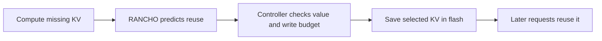

# RANCHO

Working as first author on RANCHO, an algorithm for reducing GPU memory use and prefill recomputation to improve throughput and TTFT in LLM serving, with Prof. Juncheng Yang at Harvard SEAS. I carried out the system design, implementation, and experiments, including the reuse predictor, write-budget controller, cache simulator, and vLLM integration. The manuscript is in preparation, targeting OSDI '27.

The research is ongoing. This repository provides a limited public demo so those interested can explore my implementation and run selected components on synthetic workloads. The full research implementation and evaluation remain private and under development.

## What it does

Language models use GPU memory both to process requests and to keep the **KV cache**, information already computed about earlier tokens. Later requests can reuse that KV to skip prompt processing, called **prefill**. Keeping more KV saves computation but leaves less memory for active requests.

Flash provides more space, but wears out with writes. **RANCHO learns which KV is worth keeping and controls how quickly it spends the write budget.** Moving useful KV to flash frees GPU memory for more active requests while preserving reuse.

I built this from prediction through to actual KV transfers in **vLLM**, an engine for serving language models. The aim is higher **throughput** (generated tokens per second) and lower **time to first token (TTFT)**.



## Selected result

**85% of the GPU memory used for prefix caching replaced with high-bandwidth flash (HBF)** while meeting a 95% cache-hit target (±1 percentage point).

| Policy | Prefix-cache GPU memory replaced |
| --- | ---: |
| **RANCHO** | **85%** |
| Original Random (fixed probability 0.5) | 20% |
| Access Count (K=3) | 40% |

All three use the same 16:1 capacity exchange and one-drive-write-per-day allowance: each GB of GPU memory removed adds 16 GB of flash, and daily writes average at most the flash capacity. These are selected replay-study results.

## Try it without a GPU

The CPU demo reuses the synthetic prompts from the vLLM example: eight conversations with shared beginnings, eight warm-up requests, and 1,200 measured requests. It trains the bundled example predictor and runs the C++ cache simulator.

Requires Python 3.11+, Make and a C++17 compiler. On macOS, install `libomp` for LightGBM.

```bash
python3 -m venv .venv
source .venv/bin/activate
pip install -r requirements.txt
make demo-serving
```

```text
Policy            HBM blocks   HBM saved   Cache hits   Recomputed  Flash writes
HBM only                 960        0.0%       95.12%         7200             0
RANCHO 8:1               320       66.7%       95.12%         7200          5118
RANCHO 16:1              144       85.0%       95.12%         7200          8184
```

**HBM** is the GPU's high-bandwidth memory. The demo computes cache hits, recomputation and writes using a predictor trained on synthetic examples. Writes include warm-up; cache-hit ratios exclude it. [Demo details](examples/README.md).

For a smaller walkthrough, `make demo` runs three requests through training, prediction, admission and reuse. For actual model execution, see the [GPU serving instructions](serving/RUNNING.md).

## Explore the implementation

| Component | Code |
| --- | --- |
| Reuse prediction | [Gradient-boosted model](model/model_training.py) |
| Write-budget control | [Controller](simulator/write_controller.hpp) |
| Cache simulation | [Request replay](simulator/rancho.cpp) · [Runnable demo](examples/serving_replay.py) |
| vLLM integration | [HBF copy path](serving/code/direct_backend_hbf.py) · [Overview](serving/README.md) |
| SSD integration | [Saving and restoring KV](ssd/README.md) |

Run `make test-simulator` for the synthetic cache regression cases.
