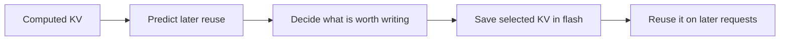

# RANCHO

I'm working on RANCHO as first author with Prof. Juncheng Yang at Harvard SEAS. I carried out the system design, implementation, and experiments, including the reuse predictor, write-budget controller, cache simulator, and vLLM integration. The manuscript is in preparation, targeting OSDI '27.

The research is ongoing. This repository provides a limited public demo so those interested can explore my implementation and run selected components on synthetic workloads. The full research implementation and evaluation remain private and under development.

## What it does

Language models use GPU memory to process requests and keep the **KV cache**, which stores information already computed about earlier tokens. Later requests can reuse that KV to skip prompt processing, called **prefill**. Keeping more KV saves computation but leaves less memory for active requests.

RANCHO predicts which KV will be reused and decides what to save in flash. Flash provides more space, but wears out with writes, so RANCHO also controls how quickly it spends its write budget.

- **High-bandwidth flash (HBF)** stores selected KV after prefill, freeing GPU memory for active requests.
- **Solid-state drives (SSDs)** save selected KV as it leaves memory, so later requests can load it back instead of computing it again.



## Results

### High-bandwidth flash

In simulator experiments, RANCHO replaced **85% of the GPU memory used for prefix caching** while meeting a 95% cache-hit target (±1 percentage point).

| Policy | KV-cache GPU memory replaced |
| --- | ---: |
| **RANCHO** | **85%** |
| Random: save each request with 50% probability | 20% |
| Access Count: save after three accesses | 40% |

Access Count waits until the first missing block has been accessed three times before saving the recomputed KV. Each GB of GPU memory removed adds 16 GB of flash. All policies have a write allowance averaging one full flash-capacity write per day.

I also integrated RANCHO into **vLLM**, an engine for serving language models. The prototype uses a separate region of GPU memory to emulate HBF and limits writes to **8 GB/s**. We test it with synthetic conversations whose shared prefixes occupy most of the baseline's KV-cache memory, leaving little room for active requests.

With **85% less KV-cache HBM**, RANCHO achieves **6.4× throughput** at the same 95.12% cache-hit ratio. The time by which 95% of requests receive their first token falls **89%**. **HBM** is the GPU's high-bandwidth memory; **throughput** is generated output tokens per second. [vLLM code and setup](serving/README.md).

### SSD

SSD caching avoids **79.5% of the repeated prefill left after memory caching** within conversations in our simulator experiments, using 48 GB of memory and a 2.304 TB SSD at one drive write per day. The memory capacity stays fixed. [SSD code](ssd/README.md).

## Try it without a GPU

Run the synthetic conversations from the vLLM example through the cache simulator on your laptop. The code trains RANCHO on earlier requests, then shows how much KV later requests reuse and how much it writes to flash.

Requires Python 3.11+, Make and a C++17 compiler. On macOS, install `libomp` for LightGBM.

```bash
python3 -m venv .venv
source .venv/bin/activate
pip install -r requirements.txt
make demo-serving
```

The demo processes 1,200 requests across eight conversations. It prints cache-hit ratios, GPU memory savings, recomputation and flash writes. In this example, RANCHO maintains a **95.12% cache-hit ratio with 85% less KV-cache HBM**.

For a three-request walkthrough, run `make demo`. [Example code](examples/README.md) · [Run with vLLM on a GPU](serving/RUNNING.md).

## Read the code

| Component | Code |
| --- | --- |
| Reuse prediction | [Gradient-boosted model](model/model_training.py) |
| Write-budget control | [Controller](simulator/write_controller.hpp) |
| Cache simulation | [Request replay](simulator/rancho.cpp) · [Runnable demo](examples/serving_replay.py) |
| vLLM integration | [HBF copy path](serving/code/direct_backend_hbf.py) |
| SSD cache replay | [Replay and independent checker](ssd/replay/README.md) |
| SSD integration | [Saving and restoring KV](ssd/README.md) |

Run `make test-simulator` for the cache tests.
