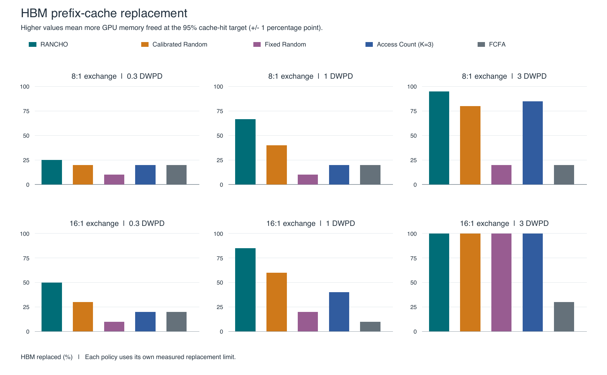
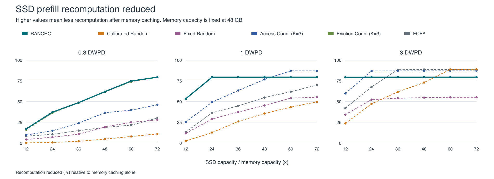

# Aggregate evaluation results

These figures compare RANCHO with online admission baselines. They report cache behavior measured by replay. The public demo uses synthetic requests to demonstrate the implementation.

## HBF replacement

The vertical axis shows the fraction of prefix-cache HBM replaced by HBF. Higher values mean more GPU memory freed. Each bar is a policy's measured replacement limit at the 95% cache-hit target, with a tolerance of one percentage point. Each policy therefore uses its own replacement level within a panel.

The hit ratio counts eligible block accesses served from the contiguous reusable prefix in either HBM or HBF, divided by all eligible accesses. An access is eligible if the previous request to access that block was in the same conversation. A missing block ends the reusable prefix even if later blocks are still cached.

At an 8:1 capacity exchange, removing 1 GB of HBM adds 8 GB of HBF. At 16:1, it adds 16 GB. Model weights stay in HBM. One drive write per day (DWPD) permits an average daily write volume equal to the flash capacity. Rewriting an evicted block consumes additional allowance.

The bars summarize the configurations recorded in the development study. They do not establish that one fixed configuration achieves every endpoint. RANCHO reaches the highest recorded replacement in all six settings, tying several baselines at 16:1 and 3 DWPD.

[Download HBF aggregate values](hbf_replacement.csv)

## SSD recomputation

The vertical axis shows the percentage of eligible prefill recomputation avoided relative to memory caching alone. Higher values mean less repeated computation. The denominator is the eligible within-conversation prompt-block computation left after the memory-cache lookup. First-time computation is outside this metric.

Memory capacity stays at 48 GB. The horizontal axis varies SSD capacity from 12 to 72 times memory capacity. Each panel uses one write allowance. Within each point, all policies receive the same cache capacities and write allowance. The allowance is enforced over the full measurement period, so individual days can spend different amounts.

The current RANCHO policy uses the same frozen rule across the SSD grid. At 48 times memory capacity and 1 DWPD, it avoids 79.5% of eligible recomputation. Eviction Count is very close at many points, and Access Count performs better at some larger capacities and allowances. The comparisons include those outcomes.

[Download SSD aggregate values](ssd_recomputation.csv)

## Baselines

| Policy | Decision rule |
| --- | --- |
| RANCHO | Predict reuse and combine the estimate with observed history and write-budget control. |
| Calibrated Random | Choose an admission probability from earlier write demand and keep it fixed during measurement. |
| Fixed Random | Accept each eligible candidate with probability 0.5, subject to the remaining write allowance. |
| Access Count (K=3), HBF | Admit the recomputed suffix when its first missing block has been accessed at least three times, including the current request. |
| Access Count (K=3), SSD | Admit a block offered at memory eviction after it has reached the three-access threshold. |
| Eviction Count (K=3), SSD | Admit a block once it has reached the third memory eviction. |
| FCFA | First-Come First-Admit. Accept candidates in arrival order while they fit the remaining write allowance. |

For HBF, a candidate is the recomputed suffix of a request. For SSD, it is an individual block leaving memory with no SSD copy. All policies must fit each accepted write within the remaining allowance.

## Scope

These aggregate measurements describe research in progress on a development workload. Repeated experiments on that workload do not establish generalization to every workload. Cache-hit and recomputation percentages measure replay behavior. Throughput and latency require separate serving measurements, described in the [serving overview](../serving/README.md).

The CSV files contain only hardware ratios, write allowances, policy names and aggregate percentages. The figures are rendered from those tables. No request contents, identities, block identifiers, workload names, source locations, trained models or raw logs accompany these results.
