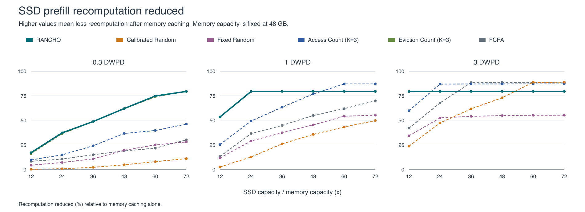

# Saving KV on SSD

An LLM saves intermediate results called **KV** so later requests can reuse earlier computation. GPU memory is limited. When it needs space for another request, some saved KV has to leave that memory.

This code lets the server **save selected KV on a solid-state drive (SSD), then load it back when it is needed again**. The aim is to avoid recomputing useful data without writing every discarded block to the drive.

## How it works

1. **GPU memory needs space.** Before the server reuses a memory slot, it considers saving the old KV on SSD. Data still being used by an active request cannot be removed.
2. **Decide what to keep.** The engine passes the block's earlier accesses, the last request's information and the write allowance to a decision function. That function returns whether to save it. The engine enforces the total write limit.
3. **Save accepted data.** The worker copies it from GPU memory to the SSD. An existing SSD copy does not need to be written again.
4. **Use it later.** If another request needs that KV, the worker reads the SSD copy back into GPU memory before the model continues.

The SSD engine integration is **under development**. The included small examples accept every write or reject every write to check that saving and restoring data works. They are not performance results or a replacement for RANCHO's learned decision rule.

## Replay results

With **48 GB of memory and a 2,304 GB SSD cache**, the current RANCHO policy reduces **eligible prefill recomputation by 79.5%** at 1 drive write per day, compared with memory caching alone.

All policies in this comparison receive the same memory capacity, SSD capacity and write allowance. Access Count saves more recomputation than RANCHO at some larger capacities and allowances. Eviction Count is also close to RANCHO at many settings.

One drive write means writing an amount of data equal to the SSD's capacity. The percentages measure how much eligible within-conversation recomputation SSD avoids after the memory-cache lookup. The allowance applies across the measurement period. These aggregate replay measurements replace the earlier SSD results shown here.

The engine examples check moving actual KV to and from SSD. The replay results measure cache policy behavior. The engine integration remains under development.

[Comparison details and baseline definitions](../results/README.md) · [Aggregate results](../results/ssd_recomputation.csv)

## Follow the code

| File | What it does |
| --- | --- |
| [run.py](run.py) | Start an example using the model and SSD location you supply. |
| [code/serve.py](code/serve.py) | Send requests to vLLM and record their outputs and response times. |
| [code/ssd_backend.py](code/ssd_backend.py) | Catch KV before GPU memory is reused, ask whether to save it and restore saved data when needed. |
| [code/ssd_policy.py](code/ssd_policy.py) | Define the information passed to the decision function. |
| [code/ssd_storage.py](code/ssd_storage.py) | Write KV to an SSD file and read it back. |
| [code/check_pair.py](code/check_pair.py) | Check that saving and restoring KV preserves the example's output. |

The code uses vLLM to run the language model. It shares page-layout and timing helpers with the [HBF serving code](../serving/README.md). No private requests, model weights or trained production predictors are included.

See [RUNNING.md](RUNNING.md) for requirements and commands.
